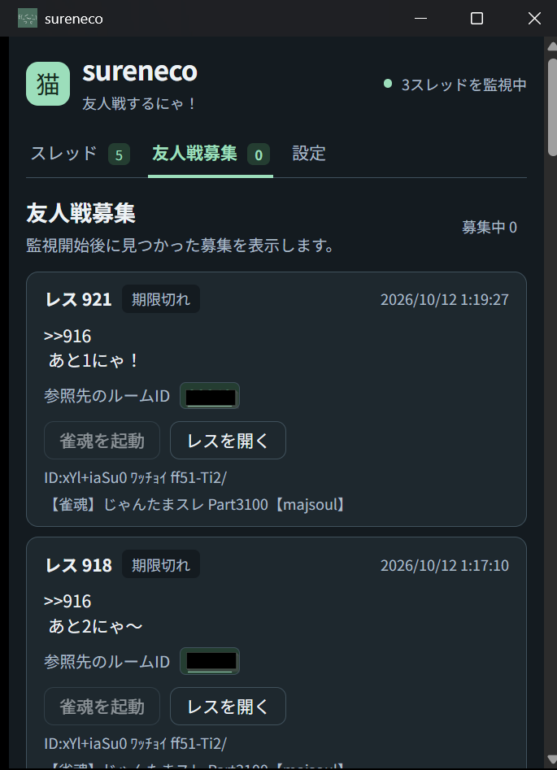

# スレネコチェッカー

5ch麻雀板の雀魂スレッドから友人戦募集を通知する、Windows / Ubuntu向け常駐アプリです。ウィンドウを閉じてもトレイで監視を続けます。

## ダウンロード

[GitHub Releases](https://github.com/sakots/sureneco/releases/latest)からダウンロードできます。

- Windows：インストーラー（`Setup.exe`）またはポータブル版（`win.zip`）
- Ubuntu：DEB（`amd64.deb`）またはAppImage
- Android：ARM64向け署名付きAPK（手動導入用）。[導入・署名の注意](docs/android.md)を確認してください。AABはローカル保管のみで、GitHubには添付しません。GitHub公開とGoogle Play公開は別です。

Tauri版のWindowsではWebView2が必要です。インストーラーは必要に応じて導入します。Electron版から切り替える場合は[移行手順](docs/usage.md#electron版からの切り替え)を確認してください。

### Icedテスト版 v0.10.1

同じ[リリースページ](https://github.com/sakots/sureneco/releases/tag/v0.10.1)に、WebViewを使わないRust／Iced版を追加配布します。Windows x64 ZIPとLinux x64 tar.gzは、名前が`sureneco-iced_`で始まるものを選んでください。Tauri版の既存配布物・更新情報は変更しません。設定はIced専用で、自動更新はありません。旧Iced版を終了してから差し替えてください。[起動方法・Linux依存関係・検証上の制約](trials/iced/README.md)を確認してください。

## 使い方

1. 通知を受けたいスレッドのトグルをオンにします。
2. 友人戦募集が見つかると通知します。検出用正規表現やNG条件は設定で変更できます。
   新しいスレッドが候補一覧に追加された場合は、トグルがオフでもスレッド名を通知します（起動時の既存一覧は通知しません）。
3. 募集のルームIDをクリックしてコピーするか、「雀魂を起動」でコピーしてゲームを開きます。

Androidのバックグラウンド通知では、**「通知を有効にする」を押す前に**、ntfyの「設定」→「一般」→「デフォルトのサーバー」を **`https://push.oekakibbs.moe`** に変更して保存してください。通知先はntfyのデフォルトサーバーに自動作成されるため、ユーザー管理の接続先だけを設定しても代わりにはなりません。その後、通知を有効にし、発行されたユーザー名・パスワードをntfyの同じサーバーへ設定します。

レス数が1000を超えたスレッドは自動的に監視を解除し、画面にスレッド名と停止理由を表示します。1000レスちょうどでは監視を継続します。

ウィンドウを閉じるとトレイに常駐し、トレイメニューから終了できます。Ubuntuではトレイに対応したデスクトップ環境が必要です。トレイを作成できない環境ではウィンドウを閉じると終了します。

設定の保存先、ログイン時の自動起動、通知条件、アプリの更新、ブラウザー・Steamの指定などは[使い方](docs/usage.md)を参照してください。

## 資料

- [端末登録・権限設定の自動化](docs/ntfy-registration-automation.md)：段階別の実装範囲と検証方法

- [使い方](docs/usage.md)：監視・通知、設定フォルダ、雀魂の起動、更新、Electron版からの切り替え
- [プライバシーポリシー](docs/privacy-policy.html)：取り扱う情報、通知サーバーへの送信、保存・削除、問い合わせ窓口。ストア掲載用HTML（公開手順は[Play提出資料](docs/google-play.md#プライバシーポリシーの公開手順)）
- [Google Play提出資料](docs/google-play.md#ストア掲載用画像)：掲載用アイコン・フィーチャーグラフィック・スマートフォン画像4枚と、登録先・代替テキスト・撮影条件
- [UnifiedPush＋自前ntfy](docs/unifiedpush-ntfy.md)：採用する通知構成、Android中継アプリ、端末認証・通知先登録と準備手順。実装と検証の進捗あり
- [運用費の比較](docs/operation-cost.md)：掲載用の既存エックスサーバーと、[人数制限を設けないVPS運用](docs/vps-cost.md)。実装は[進捗を記録](docs/server-progress.md)
- [Node.js＋VPSのサーバー構成](docs/node-vps.md)：常駐API・監視、自前ntfy、SQLite。[接続先の準備手順](docs/push-server-setup.md)にDNS・VPS・HTTPS・端末接続を記載
- [開発](docs/development.md)：構成、環境構築、起動とチェック
- [配布物の作成](docs/packaging.md)：Windows / Linuxビルド、署名、SSH先でのビルドと取得
- [仕様と変更管理](docs/specification.md)：機能別仕様、OpenSpecの手順、検証
- [Tauri移行時の構成](docs/tauri-migration.md)：技術選択と移行時の記録

Android版「スレネコチェッカー」は[開発と配布準備](docs/android.md)に現在の対応状況、[Windowsからの実機デバッグ](docs/android.md#windowsからandroid実機をデバッグする)にAPK転送・インストール・ログ取得・WebView調査の手順を記載しています。

Androidの少人数・招待制ベータは[実施方法](docs/android-beta.md)を参照してください。既存デバッグAPKの限定配布で、一般公開・Google Play配布ではありません。通知未着・403・設定保存503のリスクと報告・終了方法を記載しています。

テスターの方は[0.9.0test テスターガイド](docs/android-beta-tester.md)を参照してください。インストール、ntfy設定、試す条件、報告テンプレート、参加終了の手順をまとめています。

## 更新履歴

### [2026/11/12] v0.10.1（Icedテスト版）

- Iced版でウィンドウの位置・サイズ・最大化状態を記憶する機能を追加。専用ファイルへ保存し、再起動時に復元。保存テスト7件とLinux実画面での移動・再起動・最大化・最小化・終了直前保存を確認し、Windows版もビルド。
- Iced Windows版の通知初期化エラーが消えたことを利用者環境で確認。募集通知の実表示は未確認。
- Iced版が複数起動できてしまう問題を修正。同じ設定フォルダーの監視・通知・保存処理をOSのファイルロックで単一起動に制限。
- Iced版にダークモードを追加。設定画面で即時切替でき、配色を保存して次回起動時に復元。
- Iced版の設定操作を改善。未保存の変更があるときだけ「保存」を表示し、「保存済みに戻す」を「デフォルトに戻す」へ変更。
- Iced版のフォントをTauri版と同じ系統のNoto Sans JPへ変更。フォントを同梱してOS差を減らし、既定文字サイズを14pxに統一。
- Iced版の文字が細いとの報告に対応し、フォントをRegularから一段太いMediumへ変更。文字サイズは14pxを維持。
- Iced版にTauri版と同じ雀魂の起動機能を追加。既定ブラウザー、Chrome／Edgeのプロファイル、指定アプリ・Steamの設定を保存し、募集のルームIDをコピーして起動。
- Iced版に設定フォルダーの指定機能を追加。保存済み設定・監視対象・既読位置を安全にコピーして切り替え、再起動時も保存先を復元。既存ファイルと使用中の保存先を保護。
- Iced版のトレイを基に青地・白い猫のアプリアイコンを制作し、ウィンドウとWindows実行ファイルへ適用。
- Icedテスト版のバージョンを現行版と同じ0.10.1に統一し、既存v0.10.1へWindows x64 ZIP・Linux x64 tar.gz・専用チェックサムを追加配布。

### [2026/11/11] v0.10.1（開発中）

- 現行版と分離したPHP＋FCMの認証・通知配送試験を追加。別アプリIDの受信用APKを使用し、本番構成は変更しない。
- エックスサーバーからの実際のOAuth認証・FCM検証要求と試験APKの生成を確認。端末への到達確認は未実施。[試験結果・実機での手順](docs/operation-cost.md#phpfcmの分離した疎通試験20261111)を参照。
- PHP試験APKのPlayプロテクトによる導入ブロックを記録。署名・ハッシュ・要求権限を確認し、保護機能の無効化ではなく公式の分類審査へ進む手順を追加。実機での疎通試験は保留。
- Tauri版と同じ監視コアを使う独立したIced比較試作を追加。試作用設定を分離し、比較専用フィクスチャとプロセスツリー全体のメモリ測定を用意。Linux仮想画面で操作・保存と各3回の比較を確認。[実行手順・実測結果・制約](trials/iced/README.md)を参照。
- Iced版の日常利用向けにJSON編集を通常の設定画面へ置き換え、トレイからの表示・更新・終了とWindows／Linux通知を追加。トレイが使えない環境では閉じる操作で終了する。本番設定は引き続き分離する。10テスト、Linux仮想画面の操作・常駐／復帰・隔離通知送信とWindows向けクロスチェックに成功。Windows実機は未検証。
- Iced版の外観をTauri版に合わせ、白いカード・緑の配色とスレッド／友人戦募集／設定のタブ構成へ変更。診断情報を設定の詳細へまとめ、設定項目を用途別に整理。最小400×600での表示・操作を確認し、余分なコンソールを開かないWindows版もビルド。
- Iced Windows ZIP版で通知ID付きスタートメニューショートカットが未登録だった点を修正。通知登録時の0x80070490報告に対応し、起動時に現在のEXEを指す専用リンクを作成する。
- Iced Windows通知の0x80070490がショートカット登録だけでは解消しなかったため、未パッケージアプリの初回送信前に通知設定を照会していた順序を修正。非表示・無音の短期通知でOS側の登録を済ませ、専用履歴を削除してから設定を確認する。

### [2026/11/01] v0.10.1

- Windows・Linux・Androidをv0.10.1へ更新。AndroidのversionCodeを101へ更新。
- 募集一覧の不要な配列コピーと、使っていないHTTP・Androidテスト用の依存指定を削除。通知・表示・通信の仕様は変更しない。
- 敵対的検証でAndroid端末内テスト用APKのランナークラス欠落を検出し、必要なランナー依存だけを明示して修正。

### [2026/10/30] v0.10.0

- 新着スレッド通知の追加に伴い、Windows・Linux・Androidをv0.10.0へ更新。AndroidのversionCodeを100へ更新。
- 新しいスレッドが候補一覧に現れたとき、監視トグルにかかわらず通知する機能を追加。
- 初回一覧の一斉通知と確認済みスレッドの重複通知を抑止し、Androidのバックグラウンド通知にも対応。
- Androidの新着スレッド通知には対応する通知サーバーの更新が必要。今回のアプリ公開では本番サーバーを自動更新しない。
- 本番通知サーバーをv0.10.0へ更新し、既存登録・設定・鍵の保持、DB整合性と監視回の継続を確認。[検証結果と手順](docs/server-progress.md#本番サーバーのv0100更新準備20261030)を参照。本番の新着スレッド通知到達・AndroidのOS表示は未確認。

### [2026/10/29] v0.9.3

- Windows・Linux・Androidをv0.9.3へ更新。AndroidのversionCodeを93へ更新。
- スレッド取得中の「更新中…」を「今すぐ更新」と同じ領域に固定し、文言の切り替えで一覧が上下にずれる問題を修正。

### [2026/10/29] v0.9.2

- Windows・Linux・Androidをv0.9.2へ更新。AndroidのversionCodeを92へ更新。
- 消失した設定フォルダと同じパスを保存先に指定すると、空フォルダを再作成して成功扱いになる問題を修正。
- 参照元が期限切れ・締め済みになっても取得済みの返信募集が「募集中」のまま残る問題を修正。
- 自動登録で予約済みの通知先を別端末が購読APIから占有し、予約者の登録を妨害できる問題を修正。
- 本番通知サーバーをv0.9.2へ更新し、既存登録の保持と公開APIでの通知先予約保護を確認。

### [2026/10/27] v0.9.1

- Windows・Linux・Androidをv0.9.1へ更新。AndroidのversionCodeを91へ更新。
- Android通知の有効化前に、ntfyのデフォルトサーバーを`https://push.oekakibbs.moe`へ設定する案内を追加し、設定手順の順序を修正。
- 画面内の案内・成功メッセージ・エラーを個別に閉じるボタンを追加。閉じても監視・設定・更新処理は変更しない。
- 完走スレッドの監視停止案内が残り続ける問題を修正。発生から30秒を過ぎた更新・状態取得で案内だけを消し、監視解除は維持。

### [2026/10/27] v0.9.0（Android再提出用）

- 使用済みversionCode 5での提出を避けるため、AndroidのversionCodeを90（指定の090を整数として扱った値）へ変更。表示バージョンは0.9.0のまま維持。
- 再提出用AABのファイル名にversionCodeを含め、既存の公開済み成果物を上書きしないよう修正。

### [2026/10/27] v0.9.0

- Windows・Linux・Androidのバージョンを0.9.0へ統一。AndroidのversionCodeを5へ更新。
- Windows／Linuxにログイン時の自動起動設定を追加（既定オフ・現在のユーザーのみ）。
- Node.js版に監視停止・取得／配送エラーの状態確認を追加。
- Windows実環境とOS再ログインの確認、Androidの16KB端末での動作確認とGoogle Play提出は未実施。

### [2026/10/27] v0.8.10（開発中）

- Windows／Linuxの設定に、現在のユーザーのログイン時に自動起動する機能を追加。既定はオフで、Android版には表示しない。
- LinuxのDEB展開実行ファイル・AppImageの実画面と隔離XDG登録／解除、Windows NSISクロスビルドを確認。OSへの再ログインとWindows実環境での動作は未確認。
- VPS・Firebaseを自前運用しないPHP＋cron＋外部ntfy案と、Node.js版を優先してPHP版を保留する方針を資料に追加。
- Node.js版の状態APIへ起動時刻・監視停止の判定・取得／配送エラーの集計を追加し、強制終了・取得失敗・送信障害からの復旧を確認。
- 利用者指定のストア提出版に合わせ、Androidの表示バージョンを`0.8.10`、versionCodeを`4`へ変更。

### [2026/10/27] v0.9.0（Android提出用・未公開）

- Google Play提出用にAndroidの版を`0.9.0`／versionCode `3`へ更新し、新しいアップロード鍵で署名したAABを生成。
- Android専用の版番号でAAB名を生成するよう修正し、署名・bundletool・APK変換・16KB静的整列の[確認結果と鍵の保管手順](docs/android.md#署名付きaabの準備)を追加。

### [2026/10/27] v0.8.10

- Google Play掲載用の512pxアイコン、フィーチャーグラフィック、Android表示のスクリーンショット4枚を追加。
- ストア画像の登録手順・代替テキストと、実機ではなくサンプルデータを使ったブラウザー撮影であることを資料に追加。

### [2026/10/26] v0.8.10

- レス数が1000を超えたスレッドの監視を自動停止し、対象と理由を画面に表示する機能を追加。
- ストア掲載用の日本語プライバシーポリシーと、情報の取り扱い・保存・削除・問い合わせの案内を追加。
- 開発用pnpmを12.15.0へ更新し、書式チェックとテスト実行の設定を修正。

### [2026/10/25] v0.8.10（開発中）

- ストア掲載用の日本語プライバシーポリシーを追加し、PC・Androidの情報の取り扱い、保存・削除、GitHub Issuesへの問い合わせ方法と公開手順を記載。

### [2026/10/24] v0.9.0test（Android招待制ベータ）

- テスターへ渡せるAndroidベータの導入・通知設定・報告・参加終了ガイドを追加し、運用者向け資料と分離。
- ベータ版を識別しやすくするため、Android専用バージョンを`0.9.0-test`、配布名を`0.9.0test`へ変更。
- 招待制ベータのデバッグAPKを生成し、版・署名・16KB zip整列と転送後のSHA-256を確認。配布手順を新APKへ更新。
