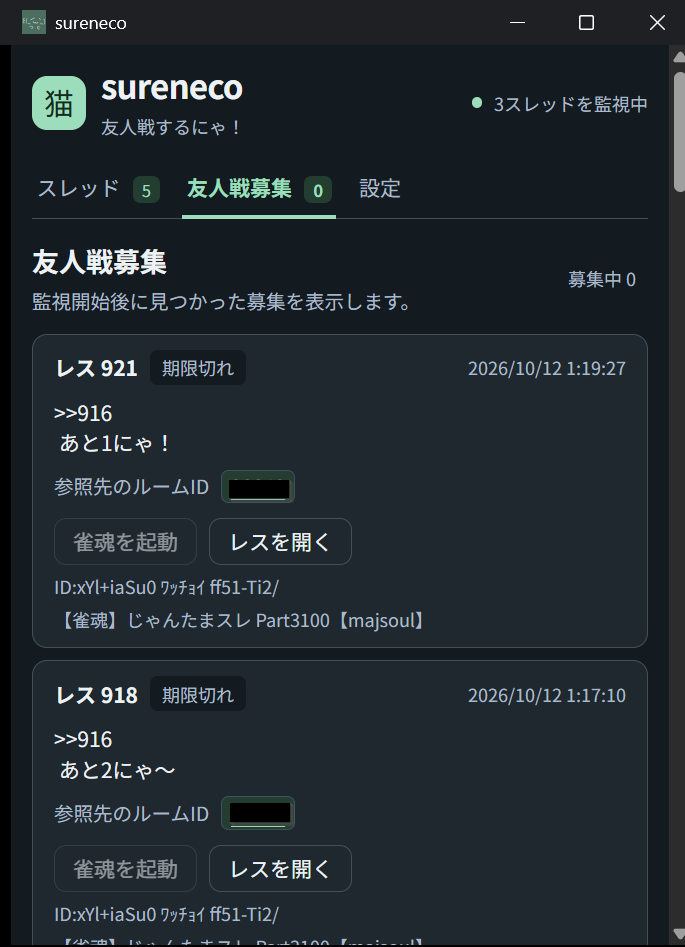

# スレネコチェッカー

5ch麻雀板の雀魂スレッドから友人戦募集を通知する、Windows / Ubuntu向け常駐アプリです。ウィンドウを閉じてもトレイで監視を続けます。

## ダウンロード

[GitHub Releases](https://github.com/sakots/sureneco/releases/latest)からダウンロードできます。

- Windows：インストーラー（`Setup.exe`）またはポータブル版（`win.zip`）
- Ubuntu：DEB（`amd64.deb`）またはAppImage

WindowsではWebView2が必要です。インストーラーは必要に応じて導入します。Electron版から切り替える場合は[移行手順](docs/usage.md#electron版からの切り替え)を確認してください。

## 使い方

1. 通知を受けたいスレッドのトグルをオンにします。
2. 友人戦募集が見つかると通知します。検出用正規表現やNG条件は設定で変更できます。
3. 募集のルームIDをクリックしてコピーするか、「雀魂を起動」でコピーしてゲームを開きます。

ウィンドウを閉じるとトレイに常駐し、トレイメニューから終了できます。Ubuntuではトレイに対応したデスクトップ環境が必要です。トレイを作成できない環境ではウィンドウを閉じると終了します。

設定の保存先、通知条件、アプリの更新、ブラウザー・Steamの指定などは[使い方](docs/usage.md)を参照してください。

## 資料

- [使い方](docs/usage.md)：監視・通知、設定フォルダ、雀魂の起動、更新、Electron版からの切り替え
- [UnifiedPush＋自前ntfy](docs/unifiedpush-ntfy.md)：採用する通知構成、Android中継アプリ、端末認証・通知先登録と準備手順。実装と検証の進捗あり
- [運用費の比較](docs/operation-cost.md)：掲載用の既存エックスサーバーと、[人数制限を設けないVPS運用](docs/vps-cost.md)。実装は[進捗を記録](docs/server-progress.md)
- [Node.js＋VPSのサーバー構成](docs/node-vps.md)：常駐API・監視、自前ntfy、SQLite。[接続先の準備手順](docs/push-server-setup.md)にDNS・VPS・HTTPS・端末接続を記載
- [開発](docs/development.md)：構成、環境構築、起動とチェック
- [配布物の作成](docs/packaging.md)：Windows / Linuxビルド、署名、SSH先でのビルドと取得
- [仕様と変更管理](docs/specification.md)：機能別仕様、OpenSpecの手順、検証
- [Tauri移行時の構成](docs/tauri-migration.md)：技術選択と移行時の記録

Android版「スレネコチェッカー」は[開発と配布準備](docs/android.md)に現在の対応状況、[Windowsからの実機デバッグ](docs/android.md#windowsからandroid実機をデバッグする)にAPK転送・インストール・ログ取得・WebView調査の手順を記載しています。

## 更新履歴

### [2026/10/23] v0.8.9（開発中）

- VPSのNode.js導入手順をNodeSourceのapt方式へ変更し、鍵生成・systemdの実行パスを`/usr/bin/node`へ統一するよう修正。
- VPSでのサーバー結合テストが5秒制限に達する問題に対処するため、テストの待ち時間と同時実行数を調整。

### [2026/10/22] v0.8.8

- 通知サーバーの起動完了通知を終了ハンドラー登録後へ移し、起動直後の正常終了が不安定になる問題を修正。
- アプリの表示名を「スレネコアラート」から「スレネコチェッカー」へ変更。画面・トレイ・通知・ランチャー・更新案内の名称を統一。
- Windows版の更新時に、アプリ自身を指す旧名のショートカットを整理するよう修正。
- 開発中のAndroid版の表示名と関連資料も新名称へ統一。今回はPC版のみ公開し、設定保存先・内部識別子・配布ファイル名は維持。

### [2026/10/22] v0.8.7

- テーマ切り替えボタンを設定画面へ移動し、上部をタイトルと監視状態だけの配置に戻すよう修正。

### [2026/10/22] v0.8.4

- PC版のアプリ名を「sureneco」から「スレネコアラート」へ変更。画面・トレイ・通知・ランチャーの表示名を統一し、設定保存先・実行ファイル名・配布ファイル名は維持。
- ライト・ダークのテーマ切り替えボタンを追加。初期値はシステム設定に追従し、選択を保存して次回起動時にも適用。
- 開発起動時にAndroid SDKやWindows向けビルドキャッシュの監視で大量のENOSPCエラーが出る問題を修正。

### [2026/10/22] v0.8.3

- 開発起動時にAndroid SDKなどの監視で大量のENOSPCエラーが出る問題を修正。
- Firebaseへの依存をなくすため、端末別認証・所有確認付きWeb Push配送とAndroidのUnifiedPush登録・受信・通知設定を追加。Firebase SDK・公開設定を削除。実ntfy配送・VPS配備・実端末確認は未実施。

- Firebaseに依存しない通知を採用するため、Android通知の計画をUnifiedPush＋自前ntfyへ修正。端末認証・中継アプリ・運用費の資料を更新し、旧Firebase設定手順を削除。実装の中断は維持。

- Node.js通知サーバーの試作機能を追加。実装を一旦中断し、契約済みエックスサーバーの活用と人数制限を設けないVPS運用の費用比較・進捗資料を追加。実Firebase・Android配送とVPS配備は未確認。

- Android通知サーバーをVPS上の常駐Node.jsへ切り替えるため、設計・仕様差分・作業項目・準備資料を修正。
- PHPサーバーの実行環境・配置・HTTPS API・環境変数・cron・動作確認のセットアップ手順を追加。
- `google-services.json`の配置先を設定資料に追加し、Git管理から除外するようにした。
- Firebase設定手順とPHPのFCM送信先のパッケージ名を、Android版の`sureneco.sakots`に合わせて修正。

### [2026/10/21] v0.8.3

- FirebaseプロジェクトとAndroid・PHPサーバーの設定、接続確認の手順を追加。
- PHPのFCM HTTP v1送信と、期限・リビジョン確認、最大5回の永続再試行を追加。実際のFirebase・Androidへの配送は未確認。
- Android配布設定にアプリID・API 36・ARM64・公開用Firebase識別子・固定HTTPS APIのビルド検証を追加。
- Android版の実装に向けて、モバイル用Cargo構成とAndroidプロジェクトの基盤を追加。
- Androidサーバーの誤ったNode.js常駐前提をPHP＋毎分cronへ訂正し、単発CLI・状態API・SQLite保存・重複実行防止を実装。Node専用コードを撤去。
- PHPにFirebase IDトークン・App Checkの署名検証と、本人の購読登録・更新・停止・削除を追加。ローカル署名とHTTP操作を検証し、実Firebase接続は未確認。
- PHPから専用QuickJSプロセスで既存の募集判定を実行し、JavaScript正規表現の構文検証・時間とメモリの制限を追加。
- Androidビルド時のデスクトップ依存混入とQuickJSのバインディング生成を修正し、ARM64のデバッグAPKを生成できるようにした。端末上の動作とプッシュ受信は未確認。
- cronの板・dat共有取得と購読別更新周期、初回・再開の通知基準、募集イベントと送信待ちの永続保存を追加。FCM実配信は未確認。
- SSH先で生成したAndroidデバッグAPKをWindowsへ転送し、Windows側のADBで実機へインストールする手順を追加。
- WindowsからAndroid実機をデバッグするため、ADBの準備、起動、Logcat保存、ChromeによるWebView調査とエラーの対処手順を追加。
- Android版の表示名を「スレネコアラート」、パッケージ名を`sureneco.sakots`へ変更し、ビルド設定と実機デバッグ手順を統一。
- PC版の画面・トレイ・通知・ランチャーの表示名を「スレネコアラート」に変更。更新互換のため内部製品名・識別子・実行ファイル名・設定保存先は維持。
- Android版をGoogle Playへ配布するための提案・仕様差分・設計・作業項目を追加。公開は未実施。
- Android版の監視方針をサーバー監視＋プッシュ通知へ変更し、バックグラウンド受信、設定同期、監視停止・登録解除の計画を追加。

### [2026/10/19] v0.8.3

- Ubuntuのアプリセンターでパッケージの説明が文字化けし、`(none)`が表示される問題を修正
- READMEの詳細手順を用途別の資料へ移し、過去の更新履歴をchangelog.mdに集約

過去の更新履歴は[changelog.md](changelog.md)を参照してください。
